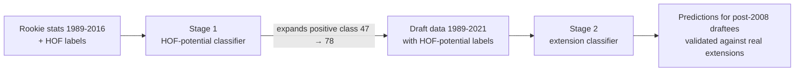

# NBA Rookie Contract Manager: ML for Contract-Extension Decisions

Can a rookie's first-season stats tell a front office whether to extend their contract? This project builds a two-stage machine-learning pipeline. Stage 1 scores **Hall-of-Fame-level potential** from rookie-year performance. Stage 2 uses that to flag which recent draftees deserve an extension.

> **Team project** for NYU Machine Learning (Fall 2024), built with Soham Roy and Devak Somaraj.

## Approach

**Data work**
- Merged two public datasets (rookie-season stats, draft-class data)
- Manually added Hall-of-Fame inductees from 2017–2024 from NBA.com, because the source data stopped at 2016
- Feature analysis: correlation heatmaps and distributions. Minutes, points and VORP were the strongest signals

**Handling severe class imbalance** (only ~4% positive)
- SMOTE oversampling, class weighting and feature scaling inside sklearn `Pipeline`s
- Model selection optimizes **recall, F1 and ROC-AUC rather than accuracy**, because accuracy is misleading at this imbalance

**Models compared:** Logistic Regression, SVM, Random Forest, Gradient Boosting, k-NN, Naive Bayes, Decision Tree, plus GridSearch tuning and Boosting / Bagging / Stacking / Voting ensembles.

## Results

| Stage | Selected model | ROC-AUC | F1 (positive class) |
|---|---|---|---|
| 1. HOF potential | AdaBoost-ed SVM | 0.83 | 0.31 |
| 2. Contract extension | Bagged Random Forest | 0.79 | 0.20 |

**Real-world check:** we compared Stage 2 predictions for post-2008 draftees with what actually happened. Flagged players like Stephen Curry, James Harden and Blake Griffin did receive extensions.

**Limitations:** there are very few positive examples (9 in the Stage 2 test set), so precision stays low and the scores have high variance. The model is best used as a screening tool that ranks candidates for human review, not as an automatic decision-maker.

## Notebooks

| Notebook | Contents |
|---|---|
| [`01_hof_potential_model.ipynb`](01_hof_potential_model.ipynb) | Data cleaning, HOF updates, EDA, 7-model comparison, ensembles |
| [`02_contract_extension_model.ipynb`](02_contract_extension_model.ipynb) | Draft-data labeling, Random Forest variants, predictions and real-world validation |

Both notebooks were built in Google Colab. Upload `NBA Rookies by Year_Hall of Fame Class.csv` and `nbaplayersdraft.csv` when prompted.

## Tech

Python · pandas · scikit-learn · imbalanced-learn (SMOTE) · matplotlib · seaborn · Google Colab
